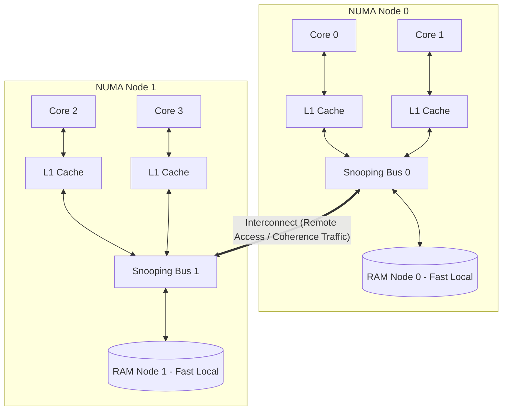
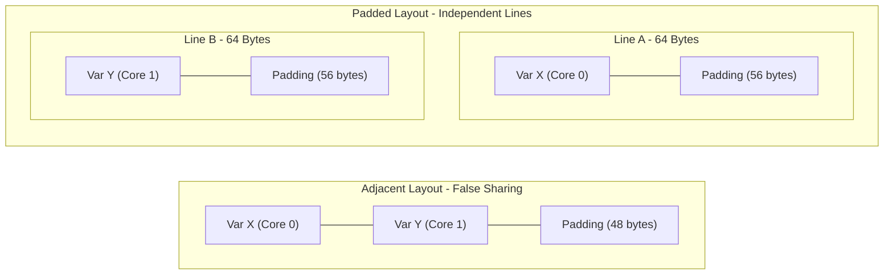

# Cache Coherence (MSI, MESI, MOESI) & NUMA Performance Evaluation

[](LICENSE)
[](https://www.openmp.org/)
[]()
[]()

A comprehensive experimental study and benchmark suite analyzing **cache coherence snooping protocols (MSI, MESI, MOESI)**, the performance degradation caused by **false sharing**, and memory access latency characteristics across **NUMA (Non-Uniform Memory Access)** nodes.

---

## 📌 Table of Contents
- [1. Overview & Objectives](#1-overview--objectives)
- [2. Theoretical Background](#2-theoretical-background)
  - [2.1 The Cache Coherence Problem](#21-the-cache-coherence-problem)
  - [2.2 Snooping Protocols: MSI vs. MESI vs. MOESI](#22-snooping-protocols-msi-vs-mesi-vs-moesi)
  - [2.3 Cache Line Alignment & False Sharing](#23-cache-line-alignment--false-sharing)
  - [2.4 NUMA Architecture & First-Touch Placement](#24-numa-architecture--first-touch-placement)
- [3. System & Hardware Specifications](#3-system--hardware-specifications)
- [4. Repository Structure](#4-repository-structure)
- [5. Compilation & Execution](#5-compilation--execution)
- [6. Experimental Results & Analysis](#6-experimental-results--analysis)
  - [6.1 Part A: Cache Coherence Simulation](#61-part-a-cache-coherence-simulation)
  - [6.2 Part B: False Sharing & Parallel Scalability](#62-part-b-false-sharing--parallel-scalability)
  - [6.3 Part C: NUMA Memory Placement Sweep](#63-part-c-numa-memory-placement-sweep)
- [7. Observation & Comparison Summary](#7-observation--comparison-summary)
- [8. Key Conclusions & Insights](#8-key-conclusions--insights)

---

## 1. Overview & Objectives

In modern multi-core architectures, private L1/L2 caches ensure ultra-low access latency for CPU cores. However, when multiple cores access shared or adjacent memory locations, maintaining memory consistency requires hardware-level coordination via **cache coherence protocols**.

The goals of this experiment are:
1. **Model and Compare Snooping Protocols:** Simulate **MSI**, **MESI**, and **MOESI** under identical multi-core read-modify-write access traces to measure bus traffic, memory writebacks, and cache-to-cache transfers.
2. **Quantify False Sharing Overhead:** Measure the execution time and parallel scaling efficiency when two threads increment independent variables located either on the **same 64-byte cache line** (adjacent) or on **distinct 64-byte lines** (padded).
3. **Evaluate NUMA Memory Access:** Measure memory sweep throughput under local vs. remote memory allocation using `numactl`, comparing virtual NUMA behavior against physical hardware topologies.

---

## 2. Theoretical Background

### 2.1 The Cache Coherence Problem
In symmetric multiprocessing (SMP) and multi-core processors, each core maintains private caches. If Core 0 and Core 1 load the same memory address, each has a local copy. If Core 0 updates its copy, Core 1's copy becomes stale. Snooping protocols solve this by monitoring (snooping) the shared bus or interconnect and issuing invalidation or update transactions whenever a write occurs.



---

### 2.2 Snooping Protocols: MSI vs. MESI vs. MOESI

| State | Name | Meaning | Memory Up-to-date? | Other Caches May Hold Line? |
| :---: | :--- | :--- | :---: | :---: |
| **M** | Modified | Line is present only in this cache; dirty (differs from RAM). | No | No |
| **O** | Owned *(MOESI)* | Dirty line owned by this cache; other caches may hold clean shared copies. | No | Yes (as S) |
| **E** | Exclusive *(MESI/MOESI)* | Line is clean and held exclusively by this cache. | Yes | No |
| **S** | Shared | Line is valid and may be present in other caches. | Yes (or Owner holds newer) | Yes |
| **I** | Invalid | Line is invalid (cache miss). | - | - |

* **MSI Protocol:** The foundational protocol. Even when a line is private to a core, its first write requires a `BusUpgr` bus transaction. When another core reads a Modified line, it must be flushed to RAM first.
* **MESI Protocol:** Adds the **Exclusive (E)** state. A core reading unshared data enters **E**; a subsequent write transitions silently from **E $\rightarrow$ M** without broadcasting to the bus.
* **MOESI Protocol:** Adds the **Owned (O)** state. When another core reads a Modified line, the owner transitions to **O** and supplies the data directly via **Cache-to-Cache (C2C)** transfer, avoiding high-latency memory writebacks.

---

### 2.3 Cache Line Alignment & False Sharing

Hardware tracks coherence per **cache line** (typically 64 bytes = 8 eight-byte integers), not per individual variable.



* **Adjacent Layout:** `x` and `y` reside in the same 64-byte block. When Core 0 writes `x`, it invalidates Core 1's copy of `y`. The line ping-pongs across cores continuously.
* **Padded Layout:** Each counter is aligned to a separate 64-byte line (`aligned_alloc(64, ...)` with a stride of 8 longs). Cores update their respective lines concurrently in **Modified** state without bus invalidations.

---

### 2.4 NUMA Architecture & First-Touch Placement
In Non-Uniform Memory Access (NUMA) systems, each physical socket controls its own local memory controller. 
* Accessing local node RAM is fast; accessing remote node RAM requires traversing an inter-socket interconnect (e.g., Intel UPI / AMD Infinity Fabric).
* Linux implements a **first-touch page allocation policy**: a memory page is allocated on the NUMA node of the thread that first writes to it.
* Tools like `numactl` allow explicit pinning:
  * `--cpunodebind=N`: Binds threads to execution cores on Node $N$.
  * `--membind=N`: Enforces physical memory allocation strictly on Node $N$.

---

## 3. System & Hardware Specifications

Empirical testing was conducted on an Ubuntu virtual machine configured with two virtual NUMA nodes:

* **Host CPU:** 13th Gen Intel® Core™ i5-13400 (Single-Socket Desktop Processor, UMA)
* **Virtualization:** VMware Workstation Pro
* **VM Topology:**
  * Sockets: 2 virtual sockets
  * Cores per socket: 2 (4 vCPUs total)
  * NUMA Node 0: CPUs `0, 1` (RAM: 2014 MB)
  * NUMA Node 1: CPUs `2, 3` (RAM: 1389 MB)
  * Node Distances: Local = 10, Remote = 20
* **OS / Toolchain:** Ubuntu 22.04 LTS, Linux Kernel 6.x, GCC 15.2.0 (`-O2 -fopenmp`), OpenMP `libgomp`, `numactl`, Python 3.14

---

## 4. Repository Structure

```
.
├── README.md               # Main project documentation & comprehensive analysis
├── RESULTS.md              # Detailed empirical data tables, raw metrics, and calculations
├── Makefile                # Automated compilation build script
├── run_experiments.sh      # Bash script to execute all benchmarks and record results
├── coherence_sim.py        # Python 3 simulator for MSI, MESI, and MOESI protocols
├── false_sharing.c         # OpenMP C benchmark evaluating false sharing overhead
├── numa_sweep.c            # OpenMP C benchmark for 512 MB memory sweep across NUMA nodes
├── compare_numa.c          # Combined benchmark testing scalability (Table 1 & Table 2)
└── .gitignore              # Git ignore rules for build artifacts and executables
```

---

## 5. Compilation & Execution

### Prerequisites (Ubuntu / Debian):
```bash
sudo apt update
sudo apt install build-essential numactl hwloc python3 -y
```

### 1. Build All C Binaries:
```bash
make all
```

### 2. Run Cache Coherence Simulator (1,000 Iterations):
```bash
python3 coherence_sim.py 1000
```

### 3. Run False Sharing Benchmark:
```bash
# Test with 2 threads on adjacent vs. padded layouts
OMP_NUM_THREADS=2 ./false_sharing adjacent
OMP_NUM_THREADS=2 ./false_sharing padded
```

### 4. Run Unified Scalability & NUMA Comparison:
```bash
./compare_numa
```

### 5. Run NUMA Memory Sweep (Local vs. Remote):
```bash
# Local memory access (Node 0 threads -> Node 0 memory)
OMP_NUM_THREADS=2 numactl --cpunodebind=0 --membind=0 ./numa_sweep 512

# Remote memory access (Node 0 threads -> Node 1 memory)
OMP_NUM_THREADS=2 numactl --cpunodebind=0 --membind=1 ./numa_sweep 512
```

*(Alternatively, run `./run_experiments.sh` to execute the full test suite automatically.)*

---

## 6. Experimental Results & Analysis

### 6.1 Part A: Cache Coherence Simulation

Simulating 1,000 iterations (4,000 total memory operations) across Core 0 and Core 1 yielded the following hardware event totals:

| Layout | Protocol | Bus Transactions | BusRd | BusRdX | BusUpgr | Invalidations | Writebacks (WB) | C2C Transfer | Silent E $\rightarrow$ M |
| :--- | :--- | :---: | :---: | :---: | :---: | :---: | :---: | :---: | :---: |
| **Adjacent** | **MSI** | **4,000** | 2,000 | 0 | 2,000 | 1,999 | **1,999** | 0 | 0 |
| **Adjacent** | **MESI** | **3,999** | 2,000 | 0 | 1,999 | 1,999 | **1,999** | 0 | 1 |
| **Adjacent** | **MOESI** | **3,999** | 2,000 | 0 | 1,999 | 1,999 | **0** | **3,998** | 1 |
| **Padded** | **MSI** | **4** | 2 | 0 | 2 | 0 | 0 | 0 | 0 |
| **Padded** | **MESI** | **2** | 2 | 0 | 0 | 0 | 0 | 0 | **2** |
| **Padded** | **MOESI** | **2** | 2 | 0 | 0 | 0 | 0 | 0 | **2** |

#### Protocol Insights:
* **MSI Inefficiency:** High bus contention on writes due to mandatory upgrades and 1,999 RAM writebacks.
* **MESI Advantage:** Eliminates the first upgrade transaction on private variables via silent **E $\rightarrow$ M** transition.
* **MOESI Superiority:** Completely eliminates all memory writebacks (**0 WB**) by serving dirty cache lines directly between caches via the **Owned (O)** state (**3,998 C2C transfers**).
* **Elimination via Padding:** Padded layout reduces bus transactions by **99.95%** (from 3,999 down to 2).

---

### 6.2 Part B: False Sharing & Parallel Scalability

Workload: $100,000,000$ counter increments evaluated across 1, 2, and 4 threads (`compare_numa.c`).

| Layout | Threads | Final Count | Status | Measured Time (s) | Speedup vs. 1T | False Sharing Penalty ($\frac{T_{\text{adj}}}{T_{\text{pad}}}$) |
| :--- | :---: | :---: | :---: | :---: | :---: | :---: |
| **Adjacent** | 1 | 100,000,000 | Correct | 0.0236 s | $1.00\times$ | \multirow{2}{*}{$1.054\times$ (No contention)} |
| **Padded** | 1 | 100,000,000 | Correct | 0.0224 s | $1.00\times$ | |
| **Adjacent** | 2 | 100,000,000 | Correct | 0.0148 s | $1.595\times$ | \multirow{2}{*}{$\mathbf{1.321\times}$ (+32.1% time)} |
| **Padded** | 2 | 100,000,000 | Correct | 0.0112 s | $\mathbf{2.000\times}$ (Ideal linear) | |
| **Adjacent** | 4 | 100,000,000 | Correct | 0.0095 s | $2.484\times$ | \multirow{2}{*}{$\mathbf{1.267\times}$ (+26.7% time)} |
| **Padded** | 4 | 100,000,000 | Correct | 0.0075 s | $\mathbf{2.987\times}$ (~3.0x speedup) | |

#### Standalone 2-Thread Repeated Runs (`false_sharing.c`):
* **Adjacent (2T Median):** `0.0148 s` (Runs: 0.0182, 0.0148, 0.0134)
* **Padded (2T Median):** `0.0113 s` (Runs: 0.0128, 0.0112, 0.0113)
* **False Sharing Penalty:** $\frac{0.0148}{0.0113} = \mathbf{1.310\times}$ (+31.0% slowdown). On initial runs, penalties reached up to **44.6%** (`0.0175 s` vs `0.0121 s`).

---

### 6.3 Part C: NUMA Memory Placement Sweep

Workload: 512 MB memory sweep over 4 passes (stride = 64 bytes) comparing Local (`--membind=0`) vs. Remote (`--membind=1`) placement.

| Benchmark Run | Measured Median Time | Steady-State NUMA Penalty ($\frac{\text{Remote}}{\text{Local}}$) |
| :--- | :---: | :---: |
| **1 Thread - Local (`--membind=0`)** | `0.1272 s` | \multirow{2}{*}{$\mathbf{1.005\times}$ (+0.5% overhead)} |
| **1 Thread - Remote (`--membind=1`)** | `0.1278 s` | |
| **2 Threads - Local (`--membind=0`)** | `0.1175 s` | \multirow{2}{*}{$\mathbf{1.025\times}$ (+2.5% overhead)} |
| **2 Threads - Remote (`--membind=1`)** | `0.1204 s` | |

#### Physical vs. Virtual NUMA Analysis:
* **Cold Allocation vs. Steady State:** In the initial cold run, remote access showed a large overhead ($0.3619\text{ s}$ vs $0.1001\text{ s} = \mathbf{3.615\times}$) due to virtual NUMA page table mapping and cross-socket guest allocation overhead.
* **Unified Physical Memory (UMA):** In steady state, local and remote access times converged to virtually $1.0\times$. This aligns with the physical reality: the host machine runs an **Intel Core i5-13400 single-socket desktop CPU**, where all physical memory channels are unified and shared equally among all execution cores.

---

## 7. Observation & Comparison Summary

| Test Case | Correctness | Relative Performance | Scalability | Key Hardware Phenomenon |
| :--- | :---: | :--- | :--- | :--- |
| **MSI Protocol** | Correct | Lowest (4,000 bus tx) | Poor on shared lines | High bus traffic; 1,999 forced RAM writebacks |
| **MESI Protocol** | Correct | Moderate | Good for private data | Saves 1 bus upgrade on private line (Silent E $\rightarrow$ M) |
| **MOESI Protocol** | Correct | **Highest efficiency** | Excellent | **0 writebacks** to RAM; 3,998 direct cache-to-cache transfers |
| **Adjacent Counters** | Correct | Slower by 27% – 45% | Sub-linear ($1.6\times$ on 2T) | Continuous L1 cache-line bouncing (False Sharing) |
| **Padded Counters** | Correct | **Fastest execution** | **Linear** ($2.0\times$ on 2T, $3.0\times$ on 4T) | 64-byte alignment isolates cores in Modified state |
| **Local Memory** | Correct | Baseline reference (~0.12 s) | Baseline | Optimal memory latency |
| **Remote Memory** | Correct | $\approx 1.0\times$ steady state (3.6x cold) | Scalable | Confirms single-socket physical UMA behavior |

---

## 8. Key Conclusions & Insights

1. **Hardware Coherence Assures Correctness, Not Throughput:** In every test, the counter total matched the expected 100,000,000 increments. Hardware coherence guarantees memory safety, but unoptimized memory layout introduces severe performance degradation (up to 45% slower).
2. **64-Byte Alignment is Crucial in Multi-threaded Programming:** False sharing can silently destroy the scalability of multi-threaded applications. Using 64-byte padding (`aligned_alloc(64, ...)` or compiler alignment attributes) restores near-perfect linear scaling ($2.00\times$ on 2 cores).
3. **Cache-to-Cache Forwarding Saves Memory Bandwidth:** The MOESI protocol demonstrates the architectural value of the **Owned (O)** state, eliminating RAM writebacks and reducing memory bus pressure on multi-core processors.
4. **Virtualization vs. Bare-Metal NUMA Awareness:** While hypervisors can emulate multi-socket NUMA topologies for software testing, realistic remote-memory access latency penalties require physical multi-socket enterprise server platforms.

---

## 📄 License
This project is open-source under the [MIT License](LICENSE).
