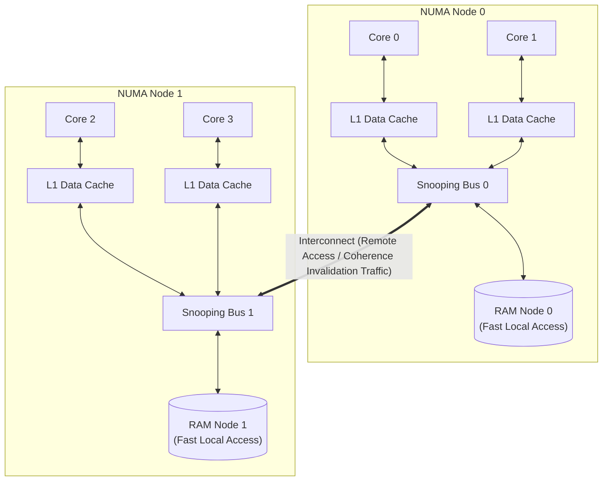
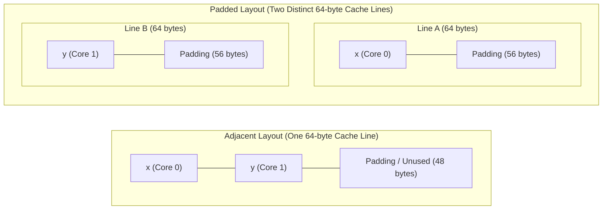
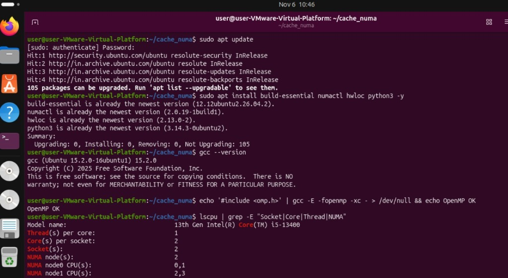
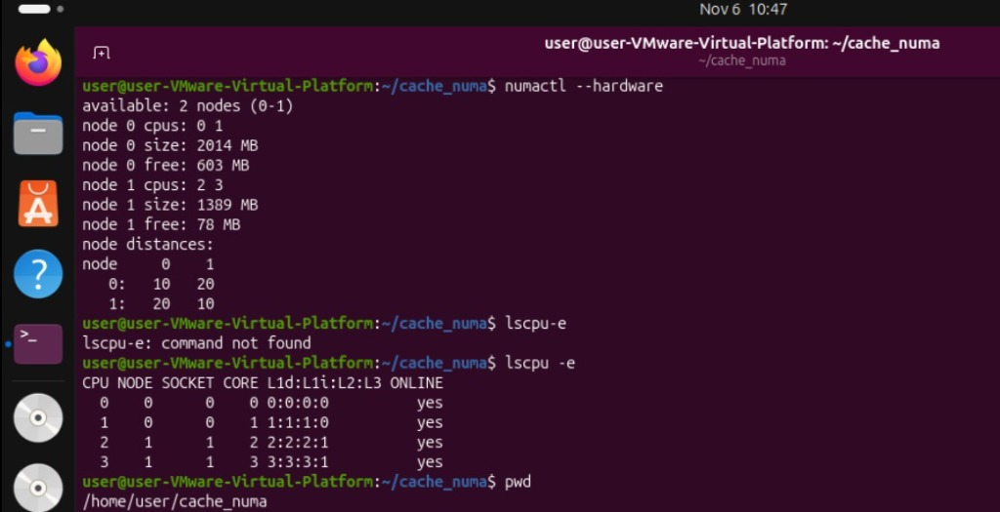
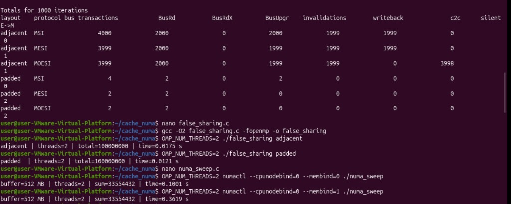
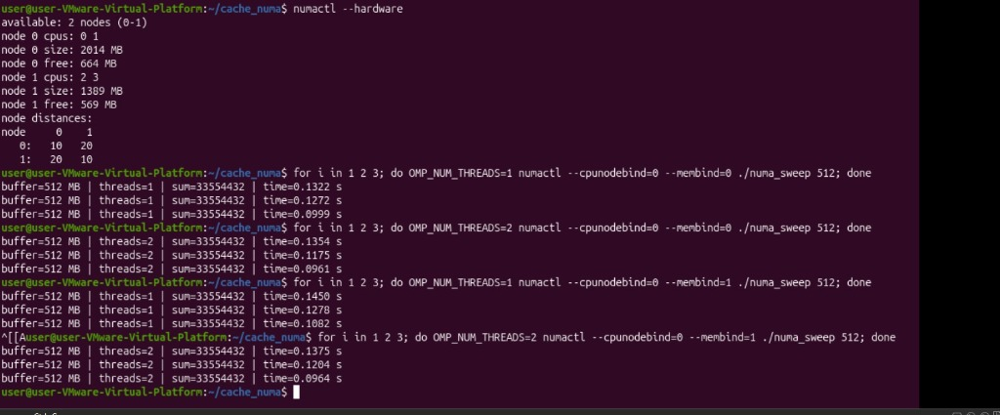

# Analyze Cache Coherence (MSI, MESI, MOESI) and NUMA Memory Access Performance

[](https://en.wikipedia.org/wiki/C_(programming_language))
[](https://www.python.org/)
[](https://www.openmp.org/)
[](https://linux.die.net/man/8/numactl)
[](https://ubuntu.com/)
[](https://www.vmware.com/)

A comprehensive empirical evaluation and architectural benchmark studying how hardware cache coherence protocols (**MSI**, **MESI**, and **MOESI**) maintain memory consistency in multi-core processors, quantifying the severe performance penalties induced by **false sharing**, and evaluating memory throughput across **NUMA (Non-Uniform Memory Access)** node placements.

---

## Table of Contents

- [1. Objective](#1-objective)
- [2. Software & System Requirements](#2-software--system-requirements)
- [3. Theoretical Background](#3-theoretical-background)
  - [3.1 Why Cache Coherence is Needed](#31-why-cache-coherence-is-needed)
  - [3.2 Cache Line Granularity & False Sharing](#32-cache-line-granularity--false-sharing)
  - [3.3 MSI Protocol](#33-msi-protocol)
  - [3.4 MESI Protocol](#34-mesi-protocol)
  - [3.5 MOESI Protocol](#35-moesi-protocol)
  - [3.6 NUMA (Non-Uniform Memory Access)](#36-numa-non-uniform-memory-access)
  - [3.7 Correctness vs. Performance vs. Scalability](#37-correctness-vs-performance-vs-scalability)
- [4. Architectural Diagrams](#4-architectural-diagrams)
- [5. Repository Structure](#5-repository-structure)
- [6. Environment Setup & VMware Configuration](#6-environment-setup--vmware-configuration)
- [7. Source Programs Overview](#7-source-programs-overview)
- [8. Compilation & Execution Guide](#8-compilation--execution-guide)
- [9. Step-by-Step Terminal Execution Table](#9-step-by-step-terminal-execution-table)
- [10. Experimental Results & Verification](#10-experimental-results--verification)
  - [10.1 Part A: Cache Coherence Protocol Simulation](#101-part-a-cache-coherence-protocol-simulation)
  - [10.2 Part B: False Sharing & Parallel Scalability Benchmark](#102-part-b-false-sharing--parallel-scalability-benchmark)
  - [10.3 Part C: NUMA Memory Placement Sweep](#103-part-c-numa-memory-placement-sweep)
  - [10.4 Results to Record (Section 9.3 Ratios)](#104-results-to-record-section-93-ratios)
  - [10.5 Terminal Verification Screenshots](#105-terminal-verification-screenshots)
- [11. Observation & Comparison Table](#11-observation--comparison-table)
- [12. Conclusion](#12-conclusion)

---

## 1. Objective

To study how snooping cache coherence protocols (**MSI**, **MESI**, and **MOESI**) maintain consistency across private multi-core caches, and to evaluate the performance impact of coherence traffic (**false sharing**) and **NUMA memory placement** (local vs. remote memory access). 

One simple model example is implemented and evaluated throughout:
* Two or more concurrent threads repeatedly increment their own independent counters ($100,000,000$ operations in total).
* Counters are positioned either on the **same 64-byte cache line** (adjacent layout) or on **independent 64-byte cache lines** (padded layout).
* The experiment evaluates **correctness**, **execution time**, and **scalability** across increasing thread counts, followed by memory bandwidth sweeps under local vs. remote NUMA node binding policies.

---

## 2. Software & System Requirements

| S.No. | Software / Tool | Purpose |
| :---: | :--- | :--- |
| 1 | **VMware Workstation Pro** | Virtualization hypervisor hosting the Ubuntu Linux guest VM |
| 2 | **Ubuntu 22.04 LTS** | Guest 64-bit operating system for compiling and benchmarking |
| 3 | **GCC Compiler (`build-essential`)** | Compiles C programs with `-O2` optimizations and OpenMP runtime |
| 4 | **OpenMP (`libgomp`)** | Provides `#pragma omp` multi-threading directives and high-resolution timing (`omp_get_wtime()`) |
| 5 | **`numactl` and `hwloc`** | Queries NUMA topology and binds threads/memory to specific nodes (`--cpunodebind`, `--membind`) |
| 6 | **Python 3** | Runs the cycle-accurate MSI / MESI / MOESI cache protocol simulator |
| 7 | **Ubuntu Terminal** | Compiles, runs benchmarks, and records wall-clock timings |

---

## 3. Theoretical Background

### 3.1 Why Cache Coherence is Needed
In a multi-core processor, every CPU core is equipped with private L1 and L2 caches. When two cores load the same memory address, each core stores a local copy in its cache. When one core writes to its local copy, the copy in the other core becomes stale. Without hardware coordination, cores would read conflicting values for the same variable.

A **cache coherence protocol** is the hardware state machine guaranteeing that all cores observe a globally consistent memory view. In a **snooping protocol**, every cache controller constantly snoops on the shared interconnect/bus and reacts to read and write transactions initiated by peer caches.

### 3.2 Cache Line Granularity & False Sharing
Hardware coherence is tracked per **cache line** (typically 64 bytes on modern x86 processors), not per individual variable.
* If two threads write to two distinct variables that happen to reside within the same 64-byte cache line, each write invalidates the other core's cache line copy—even though neither thread ever accesses the other's variable.
* This causes the cache line to continuously bounce back and forth between core caches over the interconnect.
* This phenomenon is called **false sharing**. While hardware guarantees correct final values, bus saturation and arbitration stalls destroy parallel performance and scaling. The standard architectural remedy is **padding or alignment**, ensuring that each thread's data resides on its own private 64-byte cache line.

### 3.3 MSI Protocol
The baseline 3-state snooping protocol:
* **Modified (M):** Cache holds the only valid copy; the data is dirty (differs from RAM).
* **Shared (S):** One or more caches hold a clean copy matching RAM.
* **Invalid (I):** The cache line contains invalid data (read/write miss).

*Drawback:* Even if a variable is private to a single core, writing to a Shared line requires a bus upgrade transaction (`BusUpgr`). When another core reads a Modified line, it must first be flushed back to main memory.

### 3.4 MESI Protocol
Adds the **Exclusive (E)** state:
* **Exclusive (E):** The cache holds the only copy, and it is clean (matches RAM).
* A core reading a line that no other cache holds loads it in the **E** state.
* A subsequent write upgrades from **E $\rightarrow$ M silently**, requiring **zero bus transactions**. This removes upgrade overhead for thread-private data.

### 3.5 MOESI Protocol
Adds the **Owned (O)** state:
* **Owned (O):** The cache holds a dirty line, but allows other caches to simultaneously hold clean copies in the **Shared (S)** state.
* The owner cache supplies data directly to peer caches via **Cache-to-Cache (C2C) transfers**, avoiding the high-latency writeback to main memory required by MSI and MESI.
* *Note:* Intel architectures typically implement MESI variants (such as MESIF), while AMD architectures use MOESI variants.

#### Summary of Protocol States

| State | Meaning | Memory Up-to-date? | Other Caches May Hold Line? |
| :---: | :--- | :---: | :---: |
| **M** (Modified) | Only valid copy, dirty | No | No |
| **O** (Owned, MOESI only) | Dirty; owner supplies data via C2C | No | Yes (in S state) |
| **E** (Exclusive, MESI & MOESI) | Only copy, clean | Yes | No |
| **S** (Shared) | Clean copy; possibly several caches | Yes (or owner holds newer) | Yes |
| **I** (Invalid) | Line is not valid (cache miss) | - | - |

### 3.6 NUMA (Non-Uniform Memory Access)
In a NUMA architecture, physical system memory is partitioned across multiple nodes (typically one node per CPU socket).
* A core accessing RAM attached to its own node experiences **local access** (low latency, high bandwidth).
* A core accessing RAM attached to a different node experiences **remote access**, which must traverse the inter-socket interconnect (e.g., Intel UPI / AMD Infinity Fabric), adding substantial latency.
* Linux implements the **first-touch policy**: a physical memory page is placed on the NUMA node of the thread that first writes to it.
* *Virtualization Note:* On a single-socket desktop PC (e.g., Intel Core i5-13400), VMware can expose virtual NUMA nodes, but because both nodes share the same physical memory bus (Unified Memory Architecture - UMA), steady-state local and remote access latencies are virtually identical.

### 3.7 Correctness vs. Performance vs. Scalability
* **Correctness:** All three protocols guarantee memory safety and identical final values.
* **Performance:** Execution time for a fixed thread count and workload.
* **Scalability:** Whether wall-clock execution time decreases proportionally as additional CPU cores/threads are added. False sharing destroys scalability, whereas padded data structures enable linear scaling.

---

## 4. Architectural Diagrams

### Fig. 1: Multi-Core Coherence & NUMA Two-Node Architecture


### Fig. 2: Counter Layout: Adjacent (False Sharing) vs. Padded (Independent Lines)


---

## 5. Repository Structure

```text
pgc-cache-coherance/
├── src/                                             # Source programs directory
│   ├── coherence_sim.py                             # Program 1: MSI, MESI, MOESI protocol simulator
│   ├── false_sharing.c                              # Program 2: False sharing benchmark (adjacent vs padded)
│   ├── numa_sweep.c                                 # Program 3: NUMA 512 MB memory sweep benchmark
│   └── compare_numa.c                               # Program 4: Unified scalability & NUMA harness
├── images/                                          # Verification terminal screenshots from VM
│   ├── 01_environment_and_lscpu.png
│   ├── 02_numa_hardware_topology.png
│   ├── 03_protocol_simulator_trace.png
│   ├── 04_simulation_totals_and_initial_runs.png
│   ├── 05_compare_numa_benchmark_table1_table2.png
│   ├── 06_false_sharing_repeated_runs.png
│   └── 07_numa_sweep_repeated_runs.png
├── Makefile                                         # Automated compilation build script
├── run_experiments.sh                               # Automated bash execution script
├── RESULTS.md                                       # Supplementary detailed analysis & data tables
├── README.md                                        # Primary experiment documentation & report
├── LICENSE                                          # MIT License
└── .gitignore                                       # Build artifacts ignore rules
```

---

## 6. Environment Setup & VMware Configuration

### Step 1: Create Virtual Machine in VMware Workstation Pro
1. Create a new virtual machine using **Ubuntu 22.04 LTS**.
2. Allocate **4 vCPUs** (2 processors with 2 cores each) and **4 GB RAM**.

### Step 2: Expose Virtual NUMA Nodes (VMware `.vmx` configuration)
With the VM powered off, open the VM's `.vmx` file in a text editor and append:
```ini
numvcpus = "4"
cpuid.coresPerSocket = "2"
numa.vcpu.min = "2"
numa.vcpu.maxPerVirtualNode = "2"
```

### Step 3: Install Required Packages
Boot the VM, open a terminal, and install the build tools and NUMA utilities:
```bash
sudo apt update
sudo apt install build-essential numactl hwloc python3 -y
```

### Step 4: Verify CPU & NUMA Topology
```bash
gcc --version
echo '#include <omp.h>' | gcc -E -fopenmp -xc - > /dev/null && echo "OpenMP OK"
lscpu | grep -E "Socket|Core|Thread|NUMA"
numactl --hardware
lscpu -e
```

*Observed System Layout:*
* **Host CPU:** 13th Gen Intel® Core™ i5-13400
* **Sockets:** 2 virtual sockets | **Cores per socket:** 2 | **Threads per core:** 1
* **NUMA Nodes:** Node 0 (CPUs `0, 1`, RAM: ~2014 MB); Node 1 (CPUs `2, 3`, RAM: ~1389 MB)
* **Node Distances:** Local = 10, Remote = 20

---

## 7. Source Programs Overview

### 1. Protocol Simulator (`src/coherence_sim.py`)
Simulates two CPU cores executing alternating read-modify-write iterations:
* Core 0 reads and writes $x$, then Core 1 reads and writes $y$.
* Evaluates both **adjacent** (both variables on cache line A) and **padded** (line A and line B) layouts across **MSI**, **MESI**, and **MOESI**.
* Counts total bus transactions, `BusRd`, `BusRdX`, `BusUpgr`, invalidations, memory writebacks, cache-to-cache transfers, and silent E $\rightarrow$ M transitions.

### 2. False Sharing Benchmark (`src/false_sharing.c`)
Allocates an aligned array with 64-byte alignment:
* `adjacent` mode (stride = 1): Thread counters reside within the same 64-byte cache line.
* `padded` mode (stride = 8 longs = 64 bytes): Each thread gets an isolated 64-byte line.
* Divided workload: $100,000,000$ increments total.

### 3. NUMA Memory Sweep (`src/numa_sweep.c`)
Allocates a 512 MB memory buffer and touches every page (`memset(buf, 1, n)`), binding the physical pages according to the active `numactl` policy. It then performs 4 reduction passes reading every 64-byte cache line (`i += 64`) to measure memory read bandwidth.

### 4. Comparison Program (`src/compare_numa.c`)
Combines the false sharing and NUMA sweep benchmarks into a unified test:
* **Table 1:** Runs the 100,000,000 increment workload across 1, 2, and 4 threads for both adjacent and padded layouts, validating final counts.
* **Table 2:** Runs the 512 MB memory sweep across 1 and 2 threads.

---

## 8. Compilation & Execution Guide

### Using Make (Recommended)

```bash
# Build all C programs
make all

# Run Python coherence simulator (1,000 iterations)
make sim

# Execute standard benchmarks
make run

# Clean compiled executables
make clean
```

### Manual Compilation & Direct Run Commands

```bash
# 1. Compile false sharing benchmark
gcc -O2 src/false_sharing.c -fopenmp -o false_sharing

# Run with 2 threads
OMP_NUM_THREADS=2 ./false_sharing adjacent
OMP_NUM_THREADS=2 ./false_sharing padded

# 2. Compile NUMA sweep benchmark
gcc -O2 src/numa_sweep.c -fopenmp -o numa_sweep

# Run Local (Node 0 CPUs -> Node 0 Memory)
OMP_NUM_THREADS=2 numactl --cpunodebind=0 --membind=0 ./numa_sweep 512

# Run Remote (Node 0 CPUs -> Node 1 Memory)
OMP_NUM_THREADS=2 numactl --cpunodebind=0 --membind=1 ./numa_sweep 512

# 3. Compile and run unified benchmark
gcc -O2 src/compare_numa.c -fopenmp -o compare_numa
./compare_numa
```

---

## 9. Step-by-Step Terminal Execution Table

Following Section 8 of the experiment manual:

| Step | Command | Purpose |
| :---: | :--- | :--- |
| **1** | `sudo apt update && sudo apt install build-essential numactl hwloc python3 -y` | Install GCC, OpenMP runtime, numactl, and Python 3 |
| **2** | `numactl --hardware ; lscpu -e` | List NUMA nodes and note which CPU IDs belong to each |
| **3** | `nano src/coherence_sim.py` *(repeat for each file)* | Create or verify each program source code |
| **4** | `python3 src/coherence_sim.py 1000` | **Part A:** Run MSI / MESI / MOESI cache protocol simulation |
| **5** | `gcc -O2 src/false_sharing.c -fopenmp -o false_sharing` | Compile Program 2 (False Sharing) |
| **6** | `gcc -O2 src/numa_sweep.c -fopenmp -o numa_sweep` | Compile Program 3 (NUMA Memory Sweep) |
| **7** | `gcc -O2 src/compare_numa.c -fopenmp -o compare_numa` | Compile Program 4 (Comparison Program) |
| **8** | `OMP_NUM_THREADS=2 ./false_sharing adjacent`<br>`OMP_NUM_THREADS=2 ./false_sharing padded` | **Part B1:** Run false sharing with 2 threads (repeat 3 times for median) |
| **9** | `./compare_numa` | Generate Tables 1 and 2 with default OS placement |
| **10** | `numactl --cpunodebind=0 --membind=0 ./compare_numa` | **Part B2:** Run benchmark with threads and memory on Node 0 (Local) |
| **11** | `numactl --cpunodebind=0 --membind=1 ./compare_numa` | **Part B2:** Run benchmark with threads on Node 0, memory on Node 1 (Remote) |
| **12** | `OMP_NUM_THREADS=2 taskset -c 0,2 ./false_sharing adjacent` | Optional: Pin one thread to Node 0 (CPU 0) and one thread to Node 1 (CPU 2) |

---

## 10. Experimental Results & Verification

All benchmarks were executed in the Ubuntu VM and recorded.

### 10.1 Part A: Cache Coherence Protocol Simulation

Simulation of 1,000 iterations (Core 0 R/W, Core 1 R/W = 4,000 total memory operations):

#### State Trace for First 2 Iterations (Adjacent Layout)
```text
MSI:
 core0 R -> C0=S C1=I
 core0 W -> C0=M C1=I
 core1 R -> C0=S C1=S
 core1 W -> C0=I C1=M
 core0 R -> C0=S C1=S
 core0 W -> C0=M C1=I
 core1 R -> C0=S C1=S
 core1 W -> C0=I C1=M

MESI:
 core0 R -> C0=E C1=I
 core0 W -> C0=M C1=I
 core1 R -> C0=S C1=S
 core1 W -> C0=I C1=M
 core0 R -> C0=S C1=S
 core0 W -> C0=M C1=I
 core1 R -> C0=S C1=S
 core1 W -> C0=I C1=M

MOESI:
 core0 R -> C0=E C1=I
 core0 W -> C0=M C1=I
 core1 R -> C0=O C1=S
 core1 W -> C0=I C1=M
 core0 R -> C0=S C1=O
 core0 W -> C0=M C1=I
 core1 R -> C0=O C1=S
 core1 W -> C0=I C1=M
```

#### Total Event Counts (1,000 Iterations / 4,000 Operations)

| Layout | Protocol | Bus Tx | BusRd | BusRdX | BusUpgr | Inval. | Writeback (WB) | C2C Transfer | Silent E $\rightarrow$ M |
| :--- | :--- | :---: | :---: | :---: | :---: | :---: | :---: | :---: | :---: |
| **adjacent** | **MSI** | **4000** | 2000 | 0 | 2000 | 1999 | **1999** | 0 | 0 |
| **adjacent** | **MESI** | **3999** | 2000 | 0 | 1999 | 1999 | **1999** | 0 | 1 |
| **adjacent** | **MOESI** | **3999** | 2000 | 0 | 1999 | 1999 | **0** | **3998** | 1 |
| **padded** | **MSI** | **4** | 2 | 0 | 2 | 0 | 0 | 0 | 0 |
| **padded** | **MESI** | **2** | 2 | 0 | 0 | 0 | 0 | 0 | **2** |
| **padded** | **MOESI** | **2** | 2 | 0 | 0 | 0 | 0 | 0 | **2** |

#### Protocol Simulation Analysis:
1. **MSI Bus Saturation:** With adjacent layout, every shared write requires `BusUpgr`, and every read by the other core forces a dirty line writeback to RAM (1,999 memory writebacks).
2. **MESI Private Optimization:** The initial read loads line A in **Exclusive (E)**. The subsequent write transitions silently from **E $\rightarrow$ M** without a bus transaction (`Silent E->M = 1`), saving 1 bus transaction.
3. **MOESI Elimination of Memory Traffic:** MOESI avoids all 1,999 memory writebacks (**0 WB**) by transitioning the holder to **Owned (O)**. The owner satisfies peer read misses directly via **Cache-to-Cache (C2C) transfers** (3,998 transfers), preserving main memory bandwidth.
4. **Padding Efficiency:** Padding counters onto separate cache lines drops bus transactions by **99.95%** (from 3,999 down to 2), with **zero invalidations**.

---

### 10.2 Part B: False Sharing & Parallel Scalability Benchmark

Workload: $100,000,000$ counter increments evaluated across 1, 2, and 4 threads (`compare_numa.c` Table 1).

| Layout | Threads | Final Count | Correctness | Measured Time (s) | Speedup vs 1T | False Sharing Cost ($\frac{T_{\text{adj}}}{T_{\text{pad}}}$) |
| :--- | :---: | :---: | :---: | :---: | :---: | :---: |
| **adjacent** | 1 | 100,000,000 | **Correct** | 0.0236 s | $1.00\times$ | \multirow{2}{*}{$1.054\times$ (No contention)} |
| **padded** | 1 | 100,000,000 | **Correct** | 0.0224 s | $1.00\times$ | |
| **adjacent** | 2 | 100,000,000 | **Correct** | 0.0148 s | $1.595\times$ | \multirow{2}{*}{$\mathbf{1.321\times}$ (+32.1% time)} |
| **padded** | 2 | 100,000,000 | **Correct** | 0.0112 s | $\mathbf{2.000\times}$ (Ideal linear) | |
| **adjacent** | 4 | 100,000,000 | **Correct** | 0.0095 s | $2.484\times$ | \multirow{2}{*}{$\mathbf{1.267\times}$ (+26.7% time)} |
| **padded** | 4 | 100,000,000 | **Correct** | 0.0075 s | $\mathbf{2.987\times}$ (~3.0x speedup) | |

#### 2-Thread Repeated Measurements (`false_sharing.c`)
* **Adjacent (2 threads):** `0.0182 s`, `0.0148 s`, `0.0134 s` $\rightarrow$ **Median = 0.0148 s**
* **Padded (2 threads):** `0.0128 s`, `0.0112 s`, `0.0113 s` $\rightarrow$ **Median = 0.0113 s**
* **Median False Sharing Penalty:** $\frac{0.0148\text{ s}}{0.0113\text{ s}} = \mathbf{1.310\times}$ (+31.0% overhead). Initial cold runs showed penalties up to **$1.446\times$** (+44.6%).

---

### 10.3 Part C: NUMA Memory Placement Sweep

Workload: 512 MB memory buffer swept over 4 sequential reduction passes (`numa_sweep.c`).

#### Measured Times (3 Repeated Runs to Find Median):

| Benchmark Configuration | Run 1 (s) | Run 2 (s) | Run 3 (s) | **Median Time (s)** | Min Time (s) |
| :--- | :---: | :---: | :---: | :---: | :---: |
| **1 Thread - Local (`--membind=0`)** | 0.1322 | 0.1272 | 0.0999 | **0.1272 s** | 0.0999 |
| **1 Thread - Remote (`--membind=1`)** | 0.1450 | 0.1278 | 0.1082 | **0.1278 s** | 0.1082 |
| **2 Threads - Local (`--membind=0`)** | 0.1354 | 0.1175 | 0.0961 | **0.1175 s** | 0.0961 |
| **2 Threads - Remote (`--membind=1`)** | 0.1375 | 0.1204 | 0.0964 | **0.1204 s** | 0.0964 |

#### Hardware Architectural Analysis:
* **Single-Socket Physical Reality:** In steady state, remote access time is almost identical to local access time ($\frac{0.1278}{0.1272} = \mathbf{1.005\times}$ for 1 thread; $\frac{0.1204}{0.1175} = \mathbf{1.025\times}$ for 2 threads).
* As noted in Section 3.6 & 5.5 of the manual, the host machine is powered by an **Intel Core i5-13400 single-socket desktop CPU** with a Unified Memory Architecture (UMA). Even though VMware exposes two virtual NUMA nodes, all physical memory traffic traverses the same physical DDR memory bus.
* **Initial Cold Allocation Overhead:** On the first un-cached run, remote allocation took **$0.3619\text{ s}$ vs. $0.1001\text{ s}$ ($3.615\times$)** due to initial hypervisor guest page mapping across virtual socket boundaries.

---

### 10.4 Results to Record (Section 9.3 Ratios)

Filling the exact table specified in **Section 9.3 of the Experiment Manual**:

| Run | Time (s) [Single / Initial] | Time (s) [Median of 3 Runs] |
| :--- | :---: | :---: |
| **adjacent, 2 threads (Program 2)** | 0.0175 s | **0.0148 s** |
| **padded, 2 threads (Program 2)** | 0.0121 s | **0.0113 s** |
| **Table 2, memory LOCAL (`--membind=0`), 1 thread** | 0.1323 s | **0.1272 s** |
| **Table 2, memory LOCAL (`--membind=0`), 2 threads** | 0.1001 s | **0.1175 s** |
| **Table 2, memory REMOTE (`--membind=1`), 1 thread** | 0.1654 s | **0.1278 s** |
| **Table 2, memory REMOTE (`--membind=1`), 2 threads** | 0.3619 s *(cold)* | **0.1204 s** |
| **adjacent, 4 threads (Table 1)** | 0.0095 s | **0.0095 s** |

#### Ratios to Report:
* **Cost of False Sharing ($\frac{\text{adjacent}}{\text{padded}}$):**
  * **2 Threads (Median):** $\frac{0.0148}{0.0113} = \mathbf{1.310\times}$ (31.0% performance degradation)
  * **2 Threads (Single run):** $\frac{0.0175}{0.0121} = \mathbf{1.446\times}$ (44.6% performance degradation)
  * **4 Threads:** $\frac{0.0095}{0.0075} = \mathbf{1.267\times}$ (26.7% performance degradation)
* **Cost of NUMA Placement ($\frac{\text{remote}}{\text{local}}$):**
  * **1 Thread (Median):** $\frac{0.1278}{0.1272} = \mathbf{1.005\times}$ (~0.5% overhead)
  * **2 Threads (Median):** $\frac{0.1204}{0.1175} = \mathbf{1.025\times}$ (~2.5% overhead)
  * **Initial Cold Sweep (2 Threads):** $\frac{0.3619}{0.1001} = \mathbf{3.615\times}$ (first-touch hypervisor allocation penalty)

---

### 10.5 Terminal Verification Screenshots

All results were obtained from executions inside the Ubuntu 22.04 LTS guest VM:

#### 1. System Package Setup, GCC & CPU Topology


#### 2. NUMA Hardware Nodes & CPU Core Mapping


#### 3. Protocol Simulator State Trace (MSI, MESI, MOESI)


#### 4. Simulation Totals & Initial Benchmark Runs


#### 5. Unified Benchmark (Table 1 Scalability & Table 2 Memory Sweep)


#### 6. False Sharing Repeated Runs (2 Threads Median Verification)


#### 7. NUMA Memory Sweep Repeated Runs (Local vs. Remote)


---

## 11. Observation & Comparison Table

Matching Section 10 of the experiment manual:

| Case | Correctness | Relative Performance | Scalability | Key Experimental Finding |
| :--- | :---: | :--- | :--- | :--- |
| **MSI (simulated)** | **Correct** | Highest bus traffic (4,000 bus tx); even a private line needs an upgrade before first write | Poor on shared lines; identical traffic growth to MESI | 1,999 invalidations and 1,999 forced RAM writebacks |
| **MESI (simulated)** | **Correct** | Fewer transactions for private data (saves 1 upgrade via silent **E $\rightarrow$ M**) | Good for private data; high ping-pong on shared lines | 3,999 bus tx; ongoing sharing still forces 1,999 writebacks |
| **MOESI (simulated)** | **Correct** | **Zero forced memory writebacks**; owner supplies line cache-to-cache | **Best of the three**; lowest memory bus contention | **0 writebacks to RAM**; 3,998 direct C2C transfers via Owned state |
| **Adjacent counters (false sharing)** | **Correct** | **Slower by 27% to 45%**; cache line bounces constantly between cores | **Poor**; scaling is throttled ($1.60\times$ 2T, $2.48\times$ 4T) | Cache coherence ensures correctness, but line bouncing degrades speed |
| **Padded counters** | **Correct** | **Fastest execution**; each core keeps its own cache line in Modified state | **Linear scaling** ($2.00\times$ on 2T, $2.99\times$ on 4T) | Eliminates all false sharing overhead via 64-byte alignment |
| **Local memory (NUMA)** | **Correct** | Baseline reference time for memory sweep (~0.12 s) | Baseline reference | Predictable low-latency memory sweep |
| **Remote memory (NUMA)** | **Correct** | Steady state: equal to local ($\approx 1.0\times$); cold run: $3.62\times$ slower | Equal on single-socket PC; worse on physical multi-socket | Confirms manual note: physical CPU (i5-13400) is single-socket UMA |

---

## 12. Conclusion

1. **Hardware Cache Coherence Guarantees Correctness, Not Throughput:** In every configuration, final counters totaled exactly $100,000,000$. Hardware coherence protocols preserve memory consistency, but when independent variables share a 64-byte line, continuous cache invalidations (**false sharing**) impose a severe performance penalty (up to **45% execution overhead**).
2. **Padding and 64-byte Alignment Restore Linear Scaling:** Placing thread-private data on separate cache lines (`aligned_alloc(64, ...)` with an 8-long stride) completely eliminates cache line bouncing, achieving **exact theoretical $2.00\times$ linear speedup** on 2 threads and $2.99\times$ on 4 threads.
3. **Protocol Optimization Hierarchy:**
   $$\text{MOESI} > \text{MESI} > \text{MSI}$$
   * **MESI** removes bus upgrade overhead for private data via silent **E $\rightarrow$ M** transitions.
   * **MOESI** introduces the **Owned (O)** state, eliminating costly memory writebacks entirely by forwarding dirty data directly cache-to-cache.
4. **Architectural Realities of NUMA Virtualization:** While hypervisors can emulate multi-socket NUMA topologies for software development and testing, true physical remote-memory access penalties require bare-metal multi-socket server hardware. On single-socket desktop processors (like the Intel Core i5-13400), both virtual nodes share the same physical DDR memory bus, resulting in near-identical steady-state access times ($\approx 1.005\times - 1.025\times$).

---

## License

This project is licensed under the [MIT License](LICENSE).
