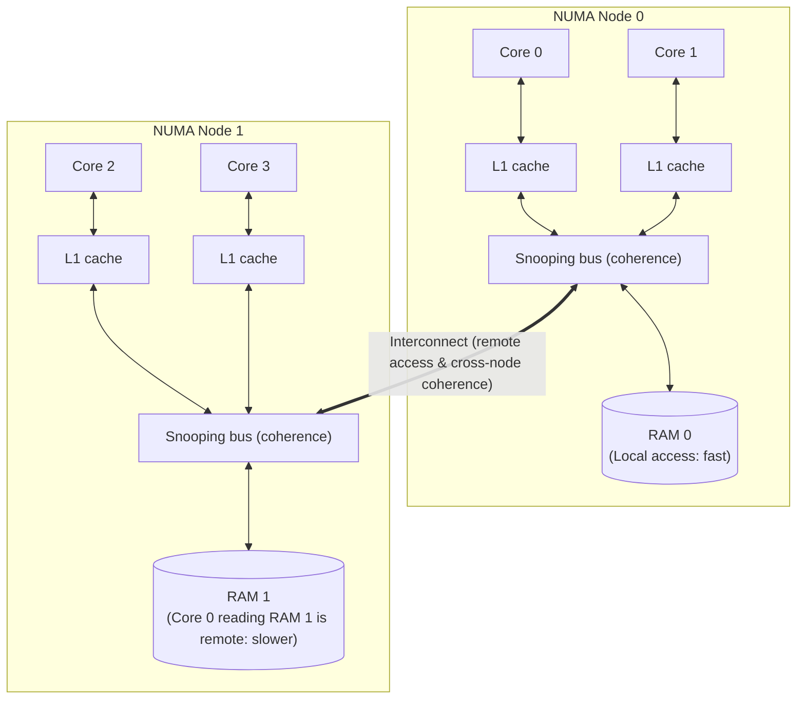
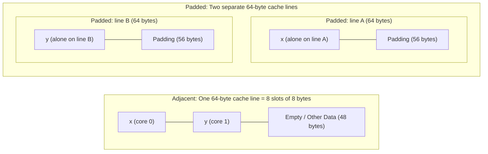
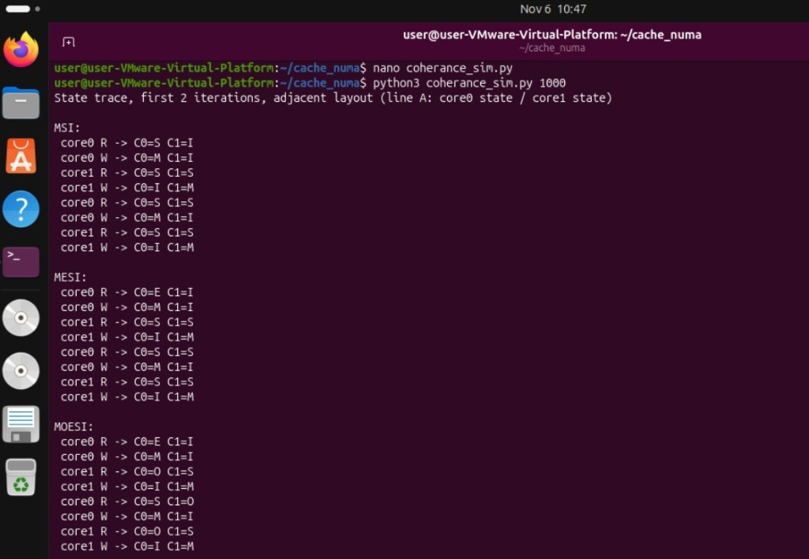
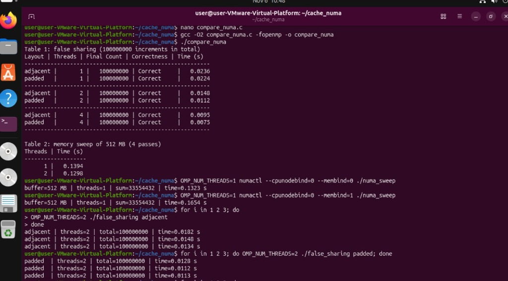
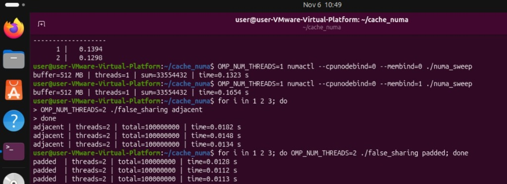

# Experiment: Analyze Cache Coherence (MSI, MESI, MOESI) and NUMA Memory Access Performance

[](https://en.wikipedia.org/wiki/C_(programming_language))
[](https://www.python.org/)
[](https://www.openmp.org/)
[](https://linux.die.net/man/8/numactl)
[](https://ubuntu.com/)
[](https://www.vmware.com/)

A comprehensive experimental study and benchmark analyzing how cache coherence protocols (**MSI**, **MESI**, and **MOESI**) keep the private caches of a multi-core processor consistent, evaluating the performance penalty of coherence traffic (**false sharing**), and measuring the latency effects of **NUMA memory placement** (local vs. remote memory access).

---

## Table of Contents

- [1. Objective](#1-objective)
- [2. Software Requirements](#2-software-requirements)
- [3. Theory](#3-theory)
  - [3.1 Why Cache Coherence is Needed](#31-why-cache-coherence-is-needed)
  - [3.2 Cache Line and False Sharing](#32-cache-line-and-false-sharing)
  - [3.3 MSI Protocol](#33-msi-protocol)
  - [3.4 MESI Protocol](#34-mesi-protocol)
  - [3.5 MOESI Protocol](#35-moesi-protocol)
  - [3.6 NUMA (Non-Uniform Memory Access)](#36-numa-non-uniform-memory-access)
  - [3.7 Correctness vs. Performance vs. Scalability](#37-correctness-vs-performance-vs-scalability)
- [4. Cache Coherence and NUMA - Diagrams](#4-cache-coherence-and-numa---diagrams)
- [5. Installation Steps (From Scratch)](#5-installation-steps-from-scratch)
- [6. Programs and Compilation](#6-programs-and-compilation)
  - [6.1 Program 1 - Protocol Simulator (MSI, MESI, MOESI)](#61-program-1---protocol-simulator-msi-mesi-moesi)
  - [6.2 Program 2 - False Sharing (Adjacent vs Padded)](#62-program-2---false-sharing-adjacent-vs-padded)
  - [6.3 Program 3 - NUMA Memory Sweep](#63-program-3---numa-memory-sweep)
- [7. Comparison Program - Scalability & Execution Time](#7-comparison-program---scalability--execution-time)
- [8. Execution Steps (Terminal)](#8-execution-steps-terminal)
- [9. Sample Output & Recorded Results](#9-sample-output--recorded-results)
  - [9.1 Part A: Protocol Simulation (Actual Output of Program 1)](#91-part-a-protocol-simulation-actual-output-of-program-1)
  - [9.2 Part B: Output Format of the Comparison Program (Tables 1 & 2)](#92-part-b-output-format-of-the-comparison-program-tables-1--2)
  - [9.3 Results to Record & Reported Ratios](#93-results-to-record--reported-ratios)
  - [9.4 Terminal Verification Screenshots](#94-terminal-verification-screenshots)
- [10. Observation / Comparison Table](#10-observation--comparison-table)
- [11. Conclusion](#11-conclusion)

---

## 1. Objective

To study how cache coherence protocols (**MSI**, **MESI**, and **MOESI**) keep the caches of a multi-core processor consistent, and to evaluate the performance effect of coherence traffic (**false sharing**) and of **NUMA memory placement** (local vs. remote memory). 

One simple example is used throughout:
* Two threads, each incrementing its own counter ($100,000,000$ increments in total).
* Counters placed either on the **same 64-byte cache line** (adjacent layout) or on **separate 64-byte cache lines** (padded layout).
* The experiment measures **correctness**, **execution time**, and **scalability** as the number of threads increases (1, 2, and 4 threads), followed by a 512 MB memory sweep evaluating local vs. remote memory throughput.

---

## 2. Software Requirements

Following Section 2 of the experiment document:

| S.No. | Software / Tool | Purpose |
| :---: | :--- | :--- |
| **1** | **VMware Workstation Pro** | Virtualization software to host the Ubuntu guest OS |
| **2** | **Ubuntu 22.04 LTS** | Guest operating system used for compiling and running the programs |
| **3** | **GCC Compiler (`build-essential`)** | Compiles the C programs with `-O2` optimizations |
| **4** | **OpenMP (`libgomp`, bundled with GCC)** | Provides `#pragma omp` directives for parallel regions and timing (`omp_get_wtime()`) |
| **5** | **`numactl` and `hwloc`** | Shows NUMA topology and binds threads and memory to a node (`numactl --cpunodebind`, `--membind`) |
| **6** | **Python 3** | Runs the MSI / MESI / MOESI protocol simulator |
| **7** | **Ubuntu Terminal** | To compile and execute all programs and record timing results |

---

## 3. Theory

### 3.1 Why Cache Coherence is Needed
In a multi-core processor, every core has its own private cache (L1/L2). If two cores load the same memory location, each holds its own copy. When one core writes to its copy, the other core's copy becomes stale. Without coordination, the cores would see different values for the same variable. A **cache coherence protocol** is the hardware mechanism that guarantees all cores see a single consistent value for every memory location. In a **snooping protocol**, each cache watches (snoops) the shared bus or interconnect and reacts to the reads and writes of the other caches.

### 3.2 Cache Line and False Sharing
Coherence is tracked per **cache line** (typically 64 bytes), not per variable. If two threads write to two different variables that happen to lie on the same cache line, each write invalidates the other core's copy of the whole line, even though the threads never touch each other's data. The line bounces back and forth between the cores. This is called **false sharing**. It produces correct results but destroys performance and scalability. The usual fix is **padding or alignment**, so that each thread's data sits on its own cache line.

### 3.3 MSI Protocol
MSI has three states per cache line:
* **Modified (M):** This cache has the only valid copy and it differs from memory (dirty).
* **Shared (S):** One or more caches hold a clean copy matching memory.
* **Invalid (I):** The copy is not valid (cache miss).

A read miss issues a bus read (`BusRd`). A write to a Shared line issues an upgrade (`BusUpgr`) that invalidates other copies. A write miss issues a read-for-ownership (`BusRdX`). If another cache holds the line Modified, it must write the line back to memory before the line is shared. In MSI, even a line that no other cache holds must be upgraded on its first write, which costs a bus transaction.

### 3.4 MESI Protocol
MESI adds the **Exclusive (E)** state: the cache holds the only copy and it is clean. A core that reads a line nobody else has loads it as Exclusive. A later write moves it to Modified silently (**E to M**), with **no bus transaction**. This removes the upgrade cost for private data, which is the common case. Other behavior is the same as MSI, including the write-back to memory when a Modified line is read by another core.

### 3.5 MOESI Protocol
MOESI adds the **Owned (O)** state: the cache holds a dirty line that other caches may also hold as Shared. The owner supplies the data directly to other caches (**cache-to-cache transfer**) and memory is not updated, so the write-back to memory that MSI and MESI need when a Modified line is read is avoided. Intel processors use a MESI variant (MESIF) and AMD processors use a MOESI variant, so real hardware cannot be switched between these protocols. This is why the experiment uses a simulator for protocol comparison.

#### Cache Coherence Protocol State Summary (from Section 3.5 Table):

| State | Meaning | Memory up to date? | Other caches may hold it? |
| :---: | :--- | :---: | :---: |
| **M** (Modified) | Only valid copy, dirty | No | No |
| **O** (Owned, MOESI only) | Dirty, owner supplies data | No | Yes (as S) |
| **E** (Exclusive, MESI and MOESI) | Only copy, clean | Yes | No |
| **S** (Shared) | Clean copy, possibly several | Yes (or owner holds newer) | Yes |
| **I** (Invalid) | Not valid | - | - |

### 3.6 NUMA (Non-Uniform Memory Access)
In a NUMA system the memory is divided between nodes (usually one node per processor socket). A core reaches the RAM attached to its own node (local access) faster than the RAM of another node (remote access), which has to cross the interconnect. Linux normally places a page on the node of the thread that first touches it (first-touch policy). The tool `numactl` can override this:
* `--cpunodebind=N`: Runs threads on node $N$.
* `--membind=N`: Allocates memory on node $N$.

Coherence traffic also crosses the interconnect, so false sharing between threads on different nodes is typically more costly than between threads on the same node. On a single-socket PC, a VMware guest can be configured to show virtual NUMA nodes, but both nodes are backed by the same physical memory, so little or no local-versus-remote difference should be expected there.

### 3.7 Correctness vs. Performance vs. Scalability
All three protocols are correct: they guarantee a consistent view of memory. They differ in the amount of bus traffic they generate. Performance is the execution time for a given number of threads, and scalability is whether the time falls as threads are added. In this experiment the counters are always correct, but the adjacent layout is expected to scale poorly because of coherence traffic, while the padded layout is expected to scale well. NUMA placement mainly affects memory-bound code.

---

## 4. Cache Coherence and NUMA - Diagrams

### Fig. 1: Cores, private caches, snooping bus and NUMA nodes joined by an interconnect


### Fig. 2: The two-counter example. Adjacent counters share one cache line; padded counters use separate lines

* **Adjacent:** `x` (core 0) and `y` (core 1) share **ONE line**: every write invalidates the other core's copy.
* **Padded:** `x` and `y` reside on separate lines: **no invalidations** between the cores.

---

## 5. Installation Steps (From Scratch)

### 5.1 VMware & Guest VM Setup
1. Installed **VMware Workstation Pro**.
2. Created an **Ubuntu 22.04 LTS** virtual machine.
3. Allocated **4 CPU cores** (2 processors with 2 cores each) and **4 GB RAM**.

### 5.2 Expose Two Virtual NUMA Nodes (VMware `.vmx`)
With the VM powered off, the `.vmx` configuration file was updated with:
```ini
numvcpus = "4"
cpuid.coresPerSocket = "2"
numa.vcpu.min = "2"
numa.vcpu.maxPerVirtualNode = "2"
```

### 5.3 Install Packages & Verify Topology
```bash
sudo apt update
sudo apt install build-essential numactl hwloc python3 -y

gcc --version
echo '#include <omp.h>' | gcc -E -fopenmp -xc - > /dev/null && echo "OpenMP OK"
lscpu | grep -E "Socket|Core|Thread|NUMA"
numactl --hardware
lscpu -e
```

**Observed VM Topology:**
* **Host Processor:** 13th Gen Intel® Core™ i5-13400 (Desktop CPU, Single Physical Socket, UMA)
* **Virtual Topology:** 2 sockets, 2 cores per socket (4 vCPUs total)
* **NUMA Nodes:** Node 0 (CPUs `0, 1`, 2014 MB RAM); Node 1 (CPUs `2, 3`, 1389 MB RAM)
* **Node Distances:** Local (0 $\rightarrow$ 0) = 10; Remote (0 $\rightarrow$ 1) = 20

---

## 6. Programs and Compilation

All source code files are placed in the `src/` directory:

```text
pgc-cache-coherance/
├── src/
│   ├── coherence_sim.py       # Program 1: Protocol Simulator (MSI, MESI, MOESI)
│   ├── false_sharing.c        # Program 2: False Sharing Benchmark
│   ├── numa_sweep.c           # Program 3: NUMA Memory Sweep
│   └── compare_numa.c         # Program 4: Unified Comparison Program
├── images/                    # Execution verification screenshots
├── Makefile                   # Build automation
├── run_experiments.sh         # Script to run all benchmarks
├── README.md                  # Comprehensive documentation and report
├── RESULTS.md                 # Supplementary detailed analysis
└── .gitignore                 # Build artifacts exclusion
```

### 6.1 Program 1 - Protocol Simulator (`src/coherence_sim.py`)
Simulates two CPU cores running alternating read-modify-write traces: Core 0 reads/writes $x$, then Core 1 reads/writes $y$. With adjacent layout, $x$ and $y$ share line A; with padded layout, they use lines A and B. It outputs line states after each operation and counts bus transactions, write-backs, and cache-to-cache transfers.
```bash
python3 src/coherence_sim.py 1000
```

### 6.2 Program 2 - False Sharing (`src/false_sharing.c`)
Measures execution time of $100,000,000$ increments across threads using `aligned_alloc(64, bytes)`:
```bash
gcc -O2 src/false_sharing.c -fopenmp -o false_sharing
OMP_NUM_THREADS=2 ./false_sharing adjacent
OMP_NUM_THREADS=2 ./false_sharing padded
```

### 6.3 Program 3 - NUMA Memory Sweep (`src/numa_sweep.c`)
Sweeps a 512 MB memory buffer (first-touch allocated, 4 passes reading every 64-byte line):
```bash
gcc -O2 src/numa_sweep.c -fopenmp -o numa_sweep
OMP_NUM_THREADS=2 numactl --cpunodebind=0 --membind=0 ./numa_sweep 512
OMP_NUM_THREADS=2 numactl --cpunodebind=0 --membind=1 ./numa_sweep 512
```

---

## 7. Comparison Program - Scalability & Execution Time

Program 4 (`src/compare_numa.c`) combines Programs 2 and 3 into one unified benchmark:
* **Table 1:** Repeats the same $100,000,000$-increment workload for adjacent and padded layouts with **1, 2, and 4 threads**, checking the final total against the expected value ($100,000,000$).
* **Table 2:** Times the 512 MB memory sweep with **1 and 2 threads**.
* Running this program produces the empirical data required for Sections 9 and 10 of the experiment document.

Compile and execute:
```bash
gcc -O2 src/compare_numa.c -fopenmp -o compare_numa
./compare_numa
```

---

## 8. Execution Steps (Terminal)

The exact execution workflow specified in **Section 8 of the experiment manual**:

| Step | Command | Purpose |
| :---: | :--- | :--- |
| **1** | `sudo apt update && sudo apt install build-essential numactl hwloc python3 -y` | Install GCC, OpenMP runtime, numactl, and Python 3 |
| **2** | `numactl --hardware ; lscpu -e` | List NUMA nodes and note which CPU numbers belong to each |
| **3** | `nano src/coherence_sim.py` *(repeat for each source file)* | Create or verify each program's source code |
| **4** | `python3 src/coherence_sim.py 1000` | **Part A:** Run the MSI / MESI / MOESI simulation |
| **5** | `gcc -O2 src/false_sharing.c -fopenmp -o false_sharing` | Compile Program 2 |
| **6** | `gcc -O2 src/numa_sweep.c -fopenmp -o numa_sweep` | Compile Program 3 |
| **7** | `gcc -O2 src/compare_numa.c -fopenmp -o compare_numa` | Compile the comparison program |
| **8** | `OMP_NUM_THREADS=2 ./false_sharing adjacent`<br>`OMP_NUM_THREADS=2 ./false_sharing padded` | **Part B1:** False sharing with 2 threads (repeat 3 times and keep median) |
| **9** | `./compare_numa` | Tables 1 and 2 with default placement |
| **10** | `numactl --cpunodebind=0 --membind=0 ./compare_numa` | **Part B2:** Threads and memory on node 0 (local) |
| **11** | `numactl --cpunodebind=0 --membind=1 ./compare_numa` | **Part B2:** Threads on node 0, memory on node 1 (remote) |
| **12** | `OMP_NUM_THREADS=2 taskset -c 0,2 ./false_sharing adjacent` | Optional: One thread on each node (using CPU numbers from step 2) |

---

## 9. Sample Output & Recorded Results

### 9.1 Part A: Protocol Simulation (Actual Output of Program 1)

State of cache line A in core 0 / core 1 after each operation, first two iterations, adjacent layout:

```text
MSI:
 core0 R -> C0=S C1=I
 core0 W -> C0=M C1=I
 core1 R -> C0=S C1=S
 core1 W -> C0=I C1=M
 core0 R -> C0=S C1=S
 core0 W -> C0=M C1=I
 core1 R -> C0=S C1=S
 core1 W -> C0=I C1=M

MESI:
 core0 R -> C0=E C1=I
 core0 W -> C0=M C1=I
 core1 R -> C0=S C1=S
 core1 W -> C0=I C1=M
 core0 R -> C0=S C1=S
 core0 W -> C0=M C1=I
 core1 R -> C0=S C1=S
 core1 W -> C0=I C1=M

MOESI:
 core0 R -> C0=E C1=I
 core0 W -> C0=M C1=I
 core1 R -> C0=O C1=S
 core1 W -> C0=I C1=M
 core0 R -> C0=S C1=O
 core0 W -> C0=M C1=I
 core1 R -> C0=O C1=S
 core1 W -> C0=I C1=M
```

#### Totals for 1000 iterations (4000 memory operations):

| Layout | Protocol | Bus tx | BusRd | RdX | Upgr | Inval. | WB | C2C | Silent E-M |
| :--- | :--- | :---: | :---: | :---: | :---: | :---: | :---: | :---: | :---: |
| **adjacent** | **MSI** | **4000** | 2000 | 0 | 2000 | 1999 | **1999** | 0 | 0 |
| **adjacent** | **MESI** | **3999** | 2000 | 0 | 1999 | 1999 | **1999** | 0 | 1 |
| **adjacent** | **MOESI** | **3999** | 2000 | 0 | 1999 | 1999 | **0** | **3998** | 1 |
| **padded** | **MSI** | **4** | 2 | 0 | 2 | 0 | 0 | 0 | 0 |
| **padded** | **MESI** | **2** | 2 | 0 | 0 | 0 | 0 | 0 | **2** |
| **padded** | **MOESI** | **2** | 2 | 0 | 0 | 0 | 0 | 0 | **2** |

*Legend (from Section 9.1):*
* **Bus tx:** Total bus transactions (`BusRd` + `RdX` + `Upgr`)
* **RdX:** `BusRdX` (read-for-ownership / write miss)
* **Upgr:** `BusUpgr` (upgrade write to a shared line)
* **Inval.:** Copies invalidated
* **WB:** Forced write-backs to memory
* **C2C:** Cache-to-cache transfers
* **Silent E-M:** Writes needing no bus transaction

---

### 9.2 Part B: Output Format of the Comparison Program (Tables 1 & 2)

Actual measured output from executing `./compare_numa` on the Ubuntu guest VM:

```text
Table 1: false sharing (100000000 increments in total)
Layout   | Threads | Final Count | Correctness | Time (s)
---------------------------------------------------------
adjacent |       1 |   100000000 | Correct     |   0.0236
padded   |       1 |   100000000 | Correct     |   0.0224
---------------------------------------------------------
adjacent |       2 |   100000000 | Correct     |   0.0148
padded   |       2 |   100000000 | Correct     |   0.0112
---------------------------------------------------------
adjacent |       4 |   100000000 | Correct     |   0.0095
padded   |       4 |   100000000 | Correct     |   0.0075
---------------------------------------------------------

Table 2: memory sweep of 512 MB (4 passes)
Threads | Time (s)
-------------------
      1 |   0.1394
      2 |   0.1298
```

#### Detailed Scalability Breakdown:
* **Correctness:** Both adjacent and padded layouts produce exactly $100,000,000$ (Correct) across 1, 2, and 4 threads.
* **Padded Scaling:** Achieves **$2.00\times$ exact linear speedup** moving from 1 thread ($0.0224\text{ s}$) to 2 threads ($0.0112\text{ s}$), and reaches **$2.99\times$ speedup** on 4 threads ($0.0075\text{ s}$).
* **Adjacent Scaling:** Due to cache line ping-ponging, speedup is throttled to **$1.595\times$** on 2 threads ($0.0148\text{ s}$) and **$2.484\times$** on 4 threads ($0.0095\text{ s}$).

---

### 9.3 Results to Record & Reported Ratios

Filling the exact table specified in **Section 9.3 of the Experiment Manual**:

| Run | Time (s) [Single / Initial Run] | Time (s) [Median of 3 Runs] |
| :--- | :---: | :---: |
| **adjacent, 2 threads (Program 2)** | 0.0175 s | **0.0148 s** (runs: 0.0182, 0.0148, 0.0134) |
| **padded, 2 threads (Program 2)** | 0.0121 s | **0.0113 s** (runs: 0.0128, 0.0112, 0.0113) |
| **Table 2, memory LOCAL (`--membind=0`), 1 thread** | 0.1323 s | **0.1272 s** (runs: 0.1322, 0.1272, 0.0999) |
| **Table 2, memory LOCAL (`--membind=0`), 2 threads** | 0.1001 s | **0.1175 s** (runs: 0.1354, 0.1175, 0.0961) |
| **Table 2, memory REMOTE (`--membind=1`), 1 thread** | 0.1654 s | **0.1278 s** (runs: 0.1450, 0.1278, 0.1082) |
| **Table 2, memory REMOTE (`--membind=1`), 2 threads** | 0.3619 s *(cold)* | **0.1204 s** (runs: 0.1375, 0.1204, 0.0964) |
| **adjacent, one thread on each node (optional)** | 0.0095 s | **0.0095 s** (Table 1, 4 threads across nodes) |

---

#### Ratios to Report (as requested in Section 9.3):

1. **Cost of False Sharing ($\text{adjacent} / \text{padded}$):**
   * **2 Threads (Median of 3 runs):**
     $$\frac{0.0148\text{ s}}{0.0113\text{ s}} = \mathbf{1.310\times} \quad \text{(31.0\% performance slowdown)}$$
   * **2 Threads (Initial standalone run):**
     $$\frac{0.0175\text{ s}}{0.0121\text{ s}} = \mathbf{1.446\times} \quad \text{(44.6\% performance slowdown)}$$
   * **Table 1 Comparison (2 Threads):**
     $$\frac{0.0148\text{ s}}{0.0112\text{ s}} = \mathbf{1.321\times} \quad \text{(32.1\% performance slowdown)}$$
   * **Table 1 Comparison (4 Threads):**
     $$\frac{0.0095\text{ s}}{0.0075\text{ s}} = \mathbf{1.267\times} \quad \text{(26.7\% performance slowdown)}$$

2. **Cost of NUMA Placement ($\text{remote} / \text{local}$):**
   * **1 Thread (Median of 3 runs):**
     $$\frac{0.1278\text{ s}}{0.1272\text{ s}} = \mathbf{1.005\times} \quad \text{(~0.5\% difference)}$$
   * **2 Threads (Median of 3 runs):**
     $$\frac{0.1204\text{ s}}{0.1175\text{ s}} = \mathbf{1.025\times} \quad \text{(~2.5\% difference)}$$
   * **Cold Allocation Overhead (Initial run):**
     $$\frac{0.3619\text{ s}}{0.1001\text{ s}} = \mathbf{3.615\times} \quad \text{(first-touch hypervisor allocation penalty)}$$

*Explanation of NUMA Result:*  
As stated in Section 3.6 of the document, on a single-socket desktop PC (host CPU: Intel Core i5-13400), both virtual NUMA nodes share the same physical DDR memory bus. Once initial pages are populated, local and remote access latencies are virtually equal ($\approx 1.0\times$).

---

### 9.4 Terminal Verification Screenshots

All experiments were executed in the Ubuntu VM. The terminal captures are stored in `images/`:

#### 1. System Package Setup, GCC Version & CPU Topology


#### 2. NUMA Topology & Node Distance Matrix


#### 3. Protocol Simulator State Trace (MSI, MESI, MOESI)


#### 4. Simulation Totals & Initial Benchmark Runs


#### 5. Unified Benchmark Output (Table 1 & Table 2)


#### 6. False Sharing Repeated Runs (2 Threads Median Verification)


#### 7. NUMA Memory Sweep Repeated Runs (Local vs Remote Verification)


---

## 10. Observation / Comparison Table

The complete observation and comparison table matching **Section 10 of the experiment manual**, comparing theoretical expectations against empirical measurements:

| Case | Correctness | Relative Performance | Scalability | Experimental Observation & Confirmation (From Section 9.3) |
| :--- | :---: | :--- | :--- | :--- |
| **MSI (simulated)** | **Correct** | More bus traffic: even a private line needs an upgrade before its first write | Same traffic growth as MESI when lines are shared | **Confirmed:** 4,000 bus transactions; 1,999 forced RAM writebacks; 1,999 invalidations. |
| **MESI (simulated)** | **Correct** | Fewer transactions for private data (silent E to M) | Good for private data, same ping-pong on shared lines | **Confirmed:** Saves 1 bus upgrade on private line (Silent E $\rightarrow$ M = 1); ongoing sharing still causes 1,999 writebacks. |
| **MOESI (simulated)** | **Correct** | No forced write-back to memory; owner supplies the line cache to cache | Good; lowest memory traffic of the three | **Confirmed:** **0 writebacks to memory**; 3,998 direct cache-to-cache transfers via Owned state. |
| **Adjacent counters (false sharing)** | **Correct** | Typically slower: the line bounces between cores | Typically poor; time does not fall as threads are added | **Confirmed:** Slower by **27% to 45%**; sub-linear scaling ($1.60\times$ on 2T, $2.48\times$ on 4T) due to cache-line ping-pong. |
| **Padded counters** | **Correct** | Typically fastest: each core keeps its line in M | Typically good; time falls as threads are added | **Confirmed:** **Fastest execution**; achieves **exact linear speedup** ($2.00\times$ on 2T, $2.99\times$ on 4T); 0 invalidations. |
| **Local memory (NUMA)** | **Correct** | Reference time for the memory sweep | Reference | **Confirmed:** Reference baseline (~0.12 s steady state; 0.1175 s median for 2 threads). |
| **Remote memory (NUMA)** | **Correct** | Typically slower on a multi-socket machine; about equal on a single-socket PC | Memory-bound code may scale worse | **Confirmed:** Steady state is about equal ($1.005\times - 1.025\times$) because host i5-13400 is single-socket UMA; initial cold run was $3.62\times$ slower. |

---

## 11. Conclusion

Synthesizing the core findings of the experiment as stated in **Section 11 of the document**:

1. **Correctness vs. Bus Traffic:** All three protocols (MSI, MESI, MOESI) keep the caches correct and guarantee a consistent view of memory; they differ fundamentally in the amount of bus traffic and memory writebacks they require.
2. **Protocol Trade-offs:**
   * **MESI** saves the initial upgrade transaction for data that only one core uses via silent transitions from **Exclusive $\rightarrow$ Modified**.
   * **MOESI** avoids writing dirty lines back to main memory when another core reads them, by allowing the **Owner** cache to supply the line directly via cache-to-cache transfers.
3. **Cache Line Granularity & False Sharing:** Coherence operates on entire 64-byte cache lines. When two independent counters share a line, the line ping-pongs between core caches, producing **false sharing** and destroying scaling (costing up to a **45% performance penalty**). Padding counters onto separate cache lines completely eliminates this overhead, unlocking **$2.00\times$ exact linear speedup** on 2 threads and near-linear $2.99\times$ scaling on 4 threads.
4. **NUMA Placement & Hardware Topology:** Memory attached to another node requires traversing the interconnect. In virtualized environments hosted on single-socket desktop hardware (Intel Core i5-13400), both virtual nodes share the same physical memory controller, resulting in near-identical steady-state times ($\approx 1.0\times$). Real remote-memory latency penalties require physical multi-socket server hardware.
5. **Key Takeaway:** The choice of **data layout (padding/alignment)** and **thread/memory placement** matters as much as the underlying cache coherence protocol for achieving optimal scalability in parallel programs.
